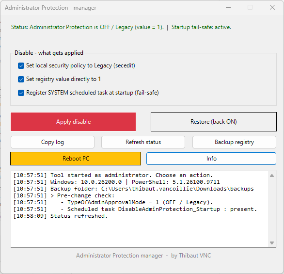

# Administrator Protection Manager

A small single-file Windows tool (`.bat` with an embedded PowerShell GUI) to **disable or re-enable Windows 11 Administrator Protection** and keep it disabled on managed devices. Ships with a **silent variant** for unattended / GPO rollout.

*by Thibaut VNC*



---

## What is Administrator Protection?

Administrator Protection is a Windows 11 security feature (shipped broadly with **KB5120998**, Aug 2026). It keeps admin accounts deprivileged and requires **Windows Hello / consent on every elevation**, using a just-in-time, profile-separated admin token. It's controlled by the policy value **`TypeOfAdminApprovalMode`**:

| Value | Meaning |
|-------|---------|
| `2`   | **ON** — Admin Approval Mode *with Administrator Protection* |
| `1`   | **OFF** — Legacy Admin Approval Mode (classic UAC behaviour) |

A **reboot is always required** for a change to take effect.

### Availability & versions

Administrator Protection became **generally available with KB5120998** (released 27 Aug 2026):

| Windows 11 version | Build with KB5120998 |
|--------------------|----------------------|
| 25H2               | 26200.9278           |
| 24H2               | 26100.9278           |

It is **off by default** on standard installs — you enable it via policy, registry or the Windows Security app. However, if your organization uses **Windows security baselines**, Administrator Protection becomes **enabled by default with the October 2026 security update**, and the baselines for **26H2, 25H2 and 24H2** all include that new default. Supported editions: Home, Pro, Enterprise, Education. Not supported on Windows 365 Cloud PCs or Azure Virtual Desktop session hosts.

---

## Files

| File | Purpose |
|------|---------|
| `ProtectionManager.bat` | Interactive GUI tool (self-elevates) |
| `ProtectionManager-Silent.bat` | Unattended / GPO rollout, no GUI, no prompts |
| `docs/screenshot.png` | GUI screenshot |

## Usage (GUI)

1. Double-click `ProtectionManager.bat`.
2. It self-elevates (UAC prompt), then opens the GUI.
3. Tick the actions you want and click **Apply disable** (or **Restore** to turn it back on).
4. Click **Reboot PC** when ready.

No install, no dependencies — runs on stock Windows PowerShell 5.1.

---

## What each option does

### 1. Local security policy (secedit)
Sets the policy **"User Account Control: Configure type of Admin Approval Mode"** to **Legacy** via `secedit`. This writes `TypeOfAdminApprovalMode = 1` as a *security policy*, so it holds as a configured setting rather than a loose registry edit. Path in `gpedit.msc`:

```
Computer Configuration > Windows Settings > Security Settings > Local Policies > Security Options
```

### 2. Registry value
Writes the value directly:

```
HKLM\SOFTWARE\Microsoft\Windows\CurrentVersion\Policies\System
    TypeOfAdminApprovalMode (REG_DWORD) = 1
```

### 3. SYSTEM scheduled task (fail-safe)
Registers a task `DisableAdminProtection_Startup` that runs **at every startup as SYSTEM** and re-writes the value to `1`. This is a safety net for managed PCs: if an Intune or domain policy pushes the value back to `2` on a policy refresh, the task puts it back on the next boot.

### Restore
Sets policy and registry back to `2` (ON) and removes the scheduled task.

---

## Safety: pre-change check and registry backup

Before **Apply disable** or **Restore** makes any change, the tool:

1. **Logs the current state** — the live `TypeOfAdminApprovalMode` value (with its meaning) and whether the fail-safe task already exists, so you can see what things were *before* the change.
2. **Backs up the registry key** — exports `HKLM\...\Policies\System` to a timestamped `.reg` file in a **`backups`** folder next to the tool (e.g. `backups\PoliciesSystem_20261016_105400.reg`). To roll back, just double-click that `.reg` file.

If the tool can't write next to itself (e.g. run from a read-only location), backups fall back to `%TEMP%`; the exact path is logged at startup and after each backup.

The **Backup registry** button does the same check + export on demand, without changing anything.

## Other buttons

- **Refresh status** — re-reads the current value and whether the fail-safe task exists.
- **Copy log** — copies the full log to the clipboard (handy for support).
- **Backup registry** — logs current state and exports the key to `backups\`, no changes made.
- **Reboot PC** — reboots after a confirmation prompt (`shutdown /r /t 5`).
- **Info** — shows the per-option explanation in-app.

---

## Silent variant & GPO rollout

`ProtectionManager-Silent.bat` does the same work with **no GUI and no prompts** — intended for a **Group Policy startup script** or any RMM/deployment tool.

```
ProtectionManager-Silent.bat            disable Administrator Protection (default)
ProtectionManager-Silent.bat /disable   same as default
ProtectionManager-Silent.bat /restore   re-enable it (and remove the fail-safe task)
ProtectionManager-Silent.bat /notask    disable, but skip the startup fail-safe task
```

It writes everything (pre-change state, backup path, each step, result) to:

```
%ProgramData%\ProtectionManager\ProtectionManager.log
%ProgramData%\ProtectionManager\backups\PoliciesSystem_<timestamp>.reg
```

**Exit codes:** `0` = all steps OK, `1` = at least one step failed (details in the log). A **reboot is required** to apply.

### Deploy as a GPO startup script

1. Put `ProtectionManager-Silent.bat` on a share the computers can read (e.g. `\\domain\NETLOGON\`).
2. **Group Policy Management** → edit a GPO → **Computer Configuration → Policies → Windows Settings → Scripts (Startup/Shutdown) → Startup**.
3. Add the script (use the `/disable` or `/restore` parameter if needed).
4. Link the GPO to the target OU. Startup scripts run as **SYSTEM**, so no elevation prompt occurs.

> Because the silent script runs as SYSTEM at boot, it both applies the setting *and* (unless `/notask`) installs the fail-safe task — handy when another policy keeps flipping the value back.

---

## Important note for managed devices (Intune / domain)

If **Intune** or a **domain GPO** actively enforces Administrator Protection (on 24H2 / 25H2 / 26H2 it's **on by default via the October 2026 security baseline**), a `gpupdate` / policy refresh can rewrite `TypeOfAdminApprovalMode` back to `2`. The startup task catches the next boot, but **not** necessarily a refresh mid-session.

The durable fix is at the **source**:
- **Intune:** Settings catalog → *Local Policies Security Options* → **User Account Control Type Of Admin Approval Mode** → disable, or exclude the device from that policy.
- **Security baseline:** adjust the baseline so it no longer enforces the setting.

This tool is a **local fail-safe, not a replacement** for fixing it at the source.

---

## Known issue this works around

On devices with Administrator Protection enabled, after **KB5124010** non-admin RDP logons can fail with `0xC000000D`. Microsoft's documented workaround is to turn Administrator Protection off — which is exactly what this tool does.

---

## How the file is built

`ProtectionManager.bat` contains the PowerShell GUI as a **base64 (UTF-16LE) blob**, written to a temp file at runtime, decoded, and executed. This avoids every quoting / BOM pitfall of embedding PowerShell inline in a batch file. `ProtectionManager-Silent.bat` is plain batch (no PowerShell), so it stays tiny and dependency-free for deployment.

---

## Safety / reversibility

Everything this tool changes is fully reversible with **Restore**. It only touches the one documented policy value plus its own scheduled task. It does **not** disable UAC, Defender, or any other security component.

---

## Sources

- [Administrator protection — Microsoft Learn](https://learn.microsoft.com/en-us/windows/security/application-security/application-control/administrator-protection)
- [LocalPoliciesSecurityOptions Policy CSP — Microsoft Learn](https://learn.microsoft.com/en-us/windows/client-management/mdm/policy-csp-localpoliciessecurityoptions)
